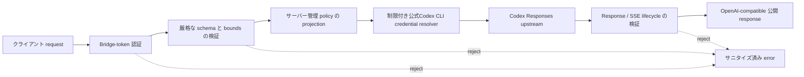

# API仕様と制約

[English (canonical)](api.md) | **日本語**

英語版を正本（canonical）とします。 [README](../README.ja.md)

| インターフェース | 対応状況 |
| --- | --- |
| `GET /healthz` | 対応。プロセスの死活確認のみ |
| `GET /readyz` | 対応。処理時間を制限した credential readiness |
| `GET /v1/models` | 対応。設定済み公開aliasだけを`codex`先頭で列挙 |
| `POST /v1/chat/completions` | 対応。SSE streaming を含む |
| `POST /v1/responses` | 実環境で検証済みの stateless subset に対応。名前付き Responses SSE events を含む |
| Function tools と tool history | 厳格な identity および call/output pairing checks 付きで対応 |
| 名前付き custom tool 1 個 | 正確な declaration、call、output replay、non-stream および stream lifecycles に対応。ブリッジが tool を実行することはない |
| Native context compaction | `context_management` を明示的に要求した場合、opaque で処理範囲を制限した checkpoint lifecycle として対応 |
| `text`、`json_object`、`json_schema` response formats | upstream の挙動を条件として対応 |
| Chat `max_tokens` と `max_completion_tokens` | SDK/Honcho との互換性のため受理し、厳格に検証する。ただし、Codex OAuth backend が `max_output_tokens` を拒否するため転送しない |
| Direct Responses `max_output_tokens` | 非対応。暗黙に無視せず拒否する |
| Reasoning、prompt cache、service tier、stream options、text verbosity | 後述する、実環境で検証済みの値に限り対応 |
| Usage projection と encrypted reasoning round-trip | 制限付きの検証を伴って対応。確認済みの `cache_write_tokens` は、SDK 3.1.0 では typed field、SDK 1.109.1 では `model_extra` に保持され、未知の usage fields は拒否される |
| `POST /v1/embeddings` | **Embeddings は非対応**。サニタイズ済みの unsupported error を返す |
| `previous_response_id`、conversations、stored response retrieval | 非対応。ブリッジは stateless を維持し、`store:false` を強制する |
| Local shell、web search、computer use、MCP、hosted tools、image input | 非対応として拒否する。機能のエミュレーションは行わない |
| clientが選択する公開model alias | server operatorが設定したaliasに限り対応 |
| clientが選択する実upstream URL/model/account/auth policy | 非対応として拒否 |
| 429、5xx、timeout、interrupted generation の自動 retry | 非対応。upstream 401 の後に限り、credential refresh/replay を正確に 1 回だけ行う |

このブリッジは、OpenAI Developer API と同等の SLA、embedding 対応、または ChatGPT/Codex subscription を service backend として恒久的に使用できる権利を保証しません。継続的にデプロイする前に、該当する製品条件と運用上の制限を確認してください。

## Direct Responses の機能契約

互換性は、OpenAI SDK の各リリースに存在するすべての field ではなく、実際の Codex backend の挙動に従います。未知の fields、未検証の enum values、stateful features、矛盾する SSE snapshots、不正または拡張された tool authority は、互換性のずれが暗黙に生じる前に拒否されます。

観測済み upstream metadata は限定した形状だけを受理します。`safety_buffering` は
`response.created`、`response.in_progress`、`response.output_text.delta`、`response.completed`
の boolean のみ、`usage.attribution` は既存の上限内の item/content と `instructions`/`tools`/`text.format` の
厳密な非負整数カウンターのみです。tool itemや空のinstructionsで観測された、itemの`content`と
`request_fields` mapの省略を許可します。検証後は Chat/Responses の公開出力・継続履歴から除外し、
terminal usage の権威は変更しません。`response.metadata` に対する既存の上限付き未知イベント処理も変更しません。

statusless reasoningは、同じitemのaddedとdoneで暗号化blobが変わらない形式も受理します。
item identityと完了イベントは引き続き必須で、履歴や別itemのblob再利用は拒否します。
未完了のreasoningを完了済みとして扱うことはありません。

要求されたreasoning summaryは、`response.reasoning_summary_part.added`、
`response.reasoning_summary_text.delta`、`response.reasoning_summary_text.done`、
`response.reasoning_summary_part.done`の厳密なライフサイクルをサポートします。
item/output/summaryの各index、蓄積したUTF-8 text、両done snapshot、終端itemのsummaryは、
既存のJSON/string/stream上限内で一致する必要があります。欠落・重複・順序違反・完了後のイベントは拒否します。
statusless reasoningの`content`は引き続き空配列のみで、summaryは上記イベントで検証します。
summaryイベントを伴わない既存のstatusful snapshot形式は維持します。
明示的に要求されたsummaryだけを同じmodel-bound item IDでResponsesに公開し、Chatには平文を出しません。
deltaの任意`obfuscation`は上限付きで検証後に除外します。
statusless/statusfulが混在する場合も、別itemの暗号化state再利用を拒否します。

現在対応している direct Responses request controls は次のとおりです。

- 設定済み公開model alias 1つ、text `input`、およびサイズ制限付きの user/developer/assistant message items。
- `instructions`。
- `reasoning.effort`: `none`、`low`、`medium`、`high`、`xhigh`、または `max`。
- `reasoning.summary`: `auto`、`concise`、または `detailed`。
- サイズ制限付きの `prompt_cache_key`。
- `service_tier="default"`。
- streaming requests のみで `stream_options={"include_obfuscation": <bool>}`。
- `text.verbosity`: `low`、`medium`、または `high`。加えて、文書化されている JSON format subset。
- function tools、または exact named choice と `parallel_tool_calls=false` を指定した custom tool ちょうど 1 個。
- `1000 <= N <= 1000000` の threshold を持つ `context_management=[{"type":"compaction","compact_threshold":N}]`。その組み合わせは backend に対して未検証であるため、compaction と function tools または custom tools は併用できません。
- `store=false` および `include=["reasoning.encrypted_content"]`。どちらの policy もサーバーが upstream で強制します。

逐次function-tool roundは、前roundのすべてのpending callに対応するoutputがある場合に対応します。
検証済みのreasoningまたはfunction callから次のroundを開始でき、reasoningから次のfunction roundを開始できますが、
すべてのparallel outputが完了した後に限ります。重複ID、繰り返しoutput、未完了のparallel round、
pending callが残る間のreasoning挿入は拒否します。

Developer messages は明示的な content-part form を使用します。Assistant replay items では、実環境で検証済みの `completed`、`in_progress`、`incomplete` status values と、任意の `commentary`/`final_answer` phase を受理します。Encrypted reasoning と compaction blobs は opaque replay authority として扱われます。ブリッジは内容をログに記録したり復号したりせず、bounds、ordering、identity、duplication を検証します。

検証済みの reasoning summaries は、クライアントが `reasoning.summary` を明示的に要求した場合に限って公開されます。要求されていない nonempty upstream summary は拒否されます。確認済みの assistant `phase` は、SDK 3.1.0 では typed field として、SDK 1.109.1 では `model_extra` を介して保持されます。

Custom-tool streaming は、backend の正確な item/input-delta lifecycle を SDK 形式の events に正規化し、provider obfuscation metadata を取り除きます。また、terminal output が省略されている場合、または完了済み items と完全一致する snapshot の場合に対応します。Provider metadata events は identity を検証したうえで破棄し、その内容を公開しません。検証済みの、両方が存在する identifier variant または両方が null の identifier variant のみを受理します。null identifiers は、衝突確認を行った決定的な public identifiers に置き換えられます。`stream_options.include_obfuscation=false` の場合、provider obfuscation field が省略されていても受理します。一方、存在するすべての obfuscation values には制限を適用し、検証します。

Offline contract tests は、固定した OpenAI Python SDK 1.109.1 と、別途 OpenAI Python SDK 3.1.0 に対して実行されます。Native compaction の typed SDK contract があるのは 3.1.0 のみです。共通の Responses request、function/custom tool、non-stream、stream subset は両方でテストされます。
