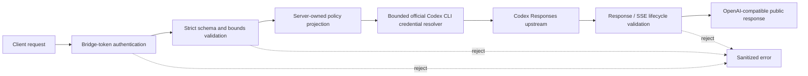

# API contract and limits

**English (canonical)** | [日本語](api.ja.md)

English is canonical if translations differ. [README](../README.md)

| Surface | Status |
| --- | --- |
| `GET /healthz` | Supported; process liveness only |
| `GET /readyz` | Supported; bounded credential readiness |
| `GET /v1/models` | Supported; lists server-approved static or discovered aliases, with `codex` first when available |
| `POST /v1/chat/completions` | Supported, including SSE streaming |
| `POST /v1/responses` | Supported for the live-proven stateless subset, including named Responses SSE events |
| Function tools and tool history | Supported with strict identity and call/output pairing checks |
| One named custom tool | Supported for exact declaration, call, output replay, non-stream, and stream lifecycles; the bridge never executes the tool |
| Native context compaction | Supported as an opaque bounded checkpoint lifecycle when `context_management` is explicitly requested |
| `text`, `json_object`, and `json_schema` response formats | Supported subject to upstream behavior |
| Chat `max_tokens` and `max_completion_tokens` | Accepted and strictly validated for SDK/Honcho compatibility, but not forwarded because the Codex OAuth backend rejects `max_output_tokens` |
| Direct Responses `max_output_tokens` | Unsupported and rejected rather than silently ignored |
| Reasoning, prompt cache, service tier, stream options, and text verbosity | Supported only for the exact live-proven values described below |
| Usage projection and encrypted reasoning round-trip | Supported with bounded validation; confirmed `cache_write_tokens` is retained as a typed field in SDK 3.1.0 and in `model_extra` in SDK 1.109.1, while unknown usage fields are rejected |
| `POST /v1/embeddings` | **Embeddings are not supported**; returns a sanitized unsupported error |
| `previous_response_id`, conversations, and stored response retrieval | Unsupported; the bridge remains stateless and forces `store:false` |
| Local shell, web search, computer use, MCP, hosted tools, and image input | Unsupported and rejected; no capability is emulated |
| Client-selected public model alias | Supported only for operator-configured or officially discovered public aliases |
| Client-selected real upstream URL/model/account/auth policy | Unsupported and rejected |
| Automatic retry of 429, 5xx, timeout, or interrupted generation | Unsupported; only one exact credential refresh/replay after upstream 401 |

The bridge does not claim OpenAI Developer API SLA equivalence, embedding support, or permanent permission to use a ChatGPT/Codex subscription as a service backend. Confirm applicable product terms and operational limits before sustained deployment.

## Direct Responses capability contract

Compatibility follows the behavior of the real Codex backend, not every field present in an
OpenAI SDK release. Unknown fields, unproven enum values, stateful features, contradictory SSE
snapshots, and malformed or expanded tool authority are rejected before they can become silent
compatibility drift.

Observed upstream metadata is accepted only in closed shapes: boolean `safety_buffering`
on `response.created`, `response.in_progress`, `response.output_text.delta`, and
`response.completed`, plus bounded `usage.attribution` item/content and `instructions`/`tools`/`text.format`
token accounting with exact nonnegative integer counters. Per-item `content` and the
`request_fields` map may be absent, as observed for tool items and empty instructions.
These private fields are validated
then stripped from Chat/Responses output and continuation; terminal usage remains authoritative.
The existing bounded unknown-event policy for `response.metadata` is unchanged.

Statusless reasoning may keep the same encrypted blob from its added event to its matching
done event. Item identity and completion are still required; historical or cross-item encrypted
blob reuse remains rejected, and unfinished reasoning is never promoted to completed authority.

Requested reasoning summaries support the strict `response.reasoning_summary_part.added`,
`response.reasoning_summary_text.delta`, `response.reasoning_summary_text.done`, and
`response.reasoning_summary_part.done` lifecycle. Item/output/summary indices, accumulated
UTF-8 text, both done snapshots, and terminal item summaries must agree within the existing
JSON/string/stream budgets. Missing, duplicate, out-of-order, or late lifecycle events fail
closed. Statusless reasoning still requires empty `content`; its summaries must be verified
through this lifecycle. Existing statusful summary snapshots without summary events remain
supported. Only explicitly requested summaries enter public Responses output, with the same
model-bound item identifiers; Chat never exposes summary plaintext. Optional delta
`obfuscation` is bounded and stripped. Cross-item encrypted-state reuse is also rejected
when statusless and statusful reasoning items are mixed.

The currently supported direct Responses request controls are:

- one configured public model alias, text `input`, and bounded user/developer/assistant message items;
- `instructions`;
- `reasoning.effort`: `none`, `low`, `medium`, `high`, `xhigh`, or `max`;
- `reasoning.summary`: `auto`, `concise`, or `detailed`;
- bounded `prompt_cache_key`;
- `service_tier="default"`;
- `stream_options={"include_obfuscation": <bool>}` on streaming requests only;
- `text.verbosity`: `low`, `medium`, or `high`, plus the documented JSON format subset;
- function tools, or exactly one custom tool with an exact named choice and
  `parallel_tool_calls=false`;
- `context_management=[{"type":"compaction","compact_threshold":N}]` with
  `1000 <= N <= 1000000`; smaller thresholds are rejected locally with HTTP 400 rather than
  sent to the backend. Compaction cannot be combined with function or custom tools because that cross-product
  has not been proven against the backend;
- `store=false` and `include=["reasoning.encrypted_content"]`; both policies are also forced
  upstream by the server.

Sequential function-tool rounds are supported when every pending call in the previous round has
a matching output. A validated reasoning item or function call may begin the next function round;
reasoning may begin the next function round only after all parallel outputs are complete. Duplicate
IDs, repeated outputs, partial parallel rounds, and reasoning inserted while calls remain pending
are rejected.

Developer messages use the explicit content-part form. Assistant replay items accept the
live-proven `completed`, `in_progress`, and `incomplete` status values and optional
`commentary`/`final_answer` phase. Encrypted reasoning and compaction blobs are opaque replay
authority: the bridge validates bounds, ordering, identity, and duplication without logging or
decrypting their contents.

Validated reasoning summaries are exposed only when the client explicitly requests
`reasoning.summary`; an unsolicited nonempty upstream summary is rejected. Confirmed assistant
`phase` is retained as a typed SDK 3.1.0 field and through `model_extra` in SDK 1.109.1.

Custom-tool streaming normalizes the backend's exact item/input-delta lifecycle into SDK-shaped
events, strips provider obfuscation metadata, and accepts either an omitted terminal output or a
snapshot exactly matching the completed items. Provider metadata events are identity-checked and
discarded without publishing their contents. Only the validated both-present or both-null identifier
variants are accepted; null identifiers are replaced with deterministic collision-checked public
identifiers. When `stream_options.include_obfuscation=false`, an omitted provider obfuscation field
is accepted while all present obfuscation values remain bounded and validated.

Compaction checkpoints may finalize their encrypted content after the matching
`response.compaction.compacting` transition. The item identity must remain fixed, the finalized
state must not reuse another checkpoint or historical state, and the terminal snapshot must match
the finalized items. A state change without that transition remains invalid.

Standard SSE comment lines, including comment-only keepalive blocks, are discarded without
publishing them or treating them as response events. They still consume the existing event/stream
byte budgets and cannot replace a completed response or extend the overall request deadline.

Offline contract tests run against the locked OpenAI Python SDK 1.109.1 and separately against
OpenAI Python SDK 3.1.0. Native compaction has a typed SDK contract only in 3.1.0; the common
Responses request, function/custom tool, non-stream, and stream subset is tested on both.
