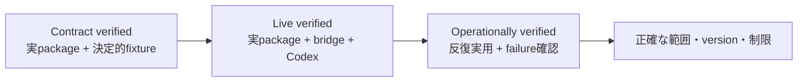

# 連携と検証範囲

[English (canonical)](integrations.md) | **日本語**

英語版を正本（canonical）とします。 [README](../README.ja.md)

Provider の機能とコンシューマー互換性は別々の契約です。ブリッジは Codex-backed API subset を狭く保ちながら、各コンシューマーが実際に送信する HTTP shape を loopback route、strict parser、upstream projection、コンシューマー固有の response parser を通してテストします。

対応状況の意味は次のとおりです。

- **Contract verified（contract検証済み）** — 固定した実packageのserializer/parserが、決定的な
  upstream fixtureに対して記載のcontractを完了しています。正確なwire shapeの証明であり、live provider利用の証明ではありません。
- **Live verified（live検証済み）** — 固定した実packageが、稼働中bridgeと実Codex backendを通して代表操作を完了しています。
- **Operationally verified（実運用検証済み）** — 実用applicationを実dataまたは実sourceで繰り返し使用し、
  記載のmulti-turn/toolおよびfailure-recovery境界まで確認しています。
- **Unsupported / external provider required（非対応／外部provider必須）** — Codex backendが能力を
  提供できないか、embedding providerなど別authorityへ意図的に分離しています。

`設定が必要`、`adapterが必要`、`範囲限定`、`役割限定`、`componentのみ`などの注記は証拠範囲を
さらに限定します。fixtureまたはserializer互換性だけでは実運用supportを意味しません。また、
どの行も記載されていないproduct surfaceのsupportを意味しません。

追加の`user-reported`は利用者の実利用報告に基づくことを示し、maintainerが独立して反復実行した証拠とは区別します。
Unhushでは通常のCustom Formatting利用だけが対象で、上記の障害復旧などの実運用境界を確認済みとは主張しません。

| コンシューマー / tool | 対応状況 | 動作確認済み version | 検証済みの範囲 | 未検証事項 / 必要条件 |
| --- | --- | --- | --- | --- |
| OpenAI Python SDK | **Live verified（live検証済み）** | 1.109.1 and 3.1.0 | live Chat/Responses non-stream/streamと、offline structured output、function/custom-tool、usage、compaction contract | `max_retries=0`を使用。非対応OpenAI API surfaceや長時間application挙動の検証ではない |
| Unhush Custom Formatting | **Operationally verified（範囲限定・user-reported）** | 報告環境でLinux AppImage 3.1.0を確認 | bridge経由の文字起こし後の整形が実用上動作しているとの利用者報告。整形sourceとsynthetic request形状は別途確認 | 整形のみでSTTは対象外。`/v1`なしのserver URLとbridge tokenが必要。textはCodexへ送信。他build/platform、UI全体、長時間利用、障害復旧は独立再検証していない |
| Honcho | **Operationally verified（実運用検証済み）** | revision `444897975c95393b0d48024470ece03c025d3aa4`を基にしたself-hosted request shape | 反復derivation、summary/dream/dialectic生成、structured output、memory-search tool continuation、再起動、queue、既存PostgreSQL/Redis continuity | Embeddingsは別backendが必要。losslessなnullable tool-call contentは現在[plastic-labs/honcho#1061](https://github.com/plastic-labs/honcho/issues/1061)のcompatibility fixが必要 |
| LangChain `ChatOpenAI` | **Operationally verified（範囲限定）** | `langchain-openai` 1.6.0、`langchain-core` 1.6.0、`langgraph` 1.2.11、`langchain` 1.3.17、`langchain-ollama` 1.1.0、`langgraph-checkpoint-sqlite` 3.1.1、OpenAI SDK 3.3.1 | live non-stream、同期stream、公式aiohttp transportによるasync Responses streaming、strict Pydantic、Responses 1-toolおよび逐次multi-tool、Chat逐次multi-tool、3-turn history、bounded `batch()`/`abatch()` concurrency（4入力・最大2）、注入した429 1回とstream途中切断1回からの回復、bounded LangGraph read-only graph、外部Ollama `embeddinggemma`によるplain-text in-memory RAG、Chat Completions modeのstandard `create_agent`、consumer-side SQLite interrupt/resume | `temperature=None`、`max_retries=0`、`use_responses_api`選択、`openai[aiohttp]`、`trust_env=False`の明示的sync/async client、`http_socket_options=()`、typed completed terminal確認が必要。persistent vector store、production corpusのretrieval評価、PostgreSQL checkpoint、checkpoint concurrent writer、multiple interrupt、standard-agent Responses mode、daemon長期利用、2を超える並列、反復exhaustion／interruptionは未検証 |
| OpenAI Agents SDK | **Live verified（設定が必要）** | `openai-agents` 0.21.1, OpenAI SDK 3.2.0 | live `OpenAIChatCompletionsModel` basic agentとlocal `function_tool` loop。offline stream contract | tracingを無効化。`OpenAIResponsesModel`、sessions、hosted toolsは未検証 |
| AutoGen | **Contract verified（adapterが必要）** | `autogen-ext`/`autogen-core`/`autogen-agentchat` 0.7.5, OpenAI SDK 3.2.0 | Direct non-stream/stream、Pydantic JSON Schema、`AssistantAgent` local function-tool/reflection contract | explicit model metadataとconditional parallel-tools adapterが必要。live継続利用、teams、code execution、memory、hosted agentsは未検証 |
| Aider | **Contract verified（役割限定）** | `aider-chat` 0.86.2, LiteLLM 1.81.10, OpenAI SDK 2.20.0 | One-shot CLI `--message` contractで既存file 1個をstreaming `whole`-format編集 | live継続利用、interactive mode、auto-commit、repo map、architect/weak-model flows、その他edit formatsは未検証 |
| Cline CLI | **Live verified（役割限定）** | Linux x64 binary 3.0.55 | 実Codexでone-shot headless `read_files` → `editor` → `submit_and_exit`編集 | local-only flagsと短いsystem promptが必要。継続利用、他platform、default control plane、shell/web/MCP/subagents/teams、IDE/TUI、non-idempotent toolsは未検証 |
| Continue core OpenAI provider | **Contract verified（componentのみ）** | `@continuedev/core` 1.1.0, `tsx` 4.23.12 | 公開`streamChat`、Edit-role `streamComplete`、non-stream function-tool result contract | Chat/Edit componentのみ。live継続利用、Apply/file mutation、現行`cn` CLI、autocomplete、embeddings、IDE UIは未検証 |

LangChainのbatch/concurrency evidenceはone-shotであり、反復batch/concurrency runは未検証です。
反復exhaustion／interruptionは未検証であり、daemon-mode利用は未検証です。
standard-agent Responses modeは未検証です。

LangGraph、RAG、standard agent、HITLの表記はconsumer-sideかつscope-exactです。
RAGは外部Ollama `embeddinggemma` backendを768 dimensionsで使用し、bridgeへEmbeddings capabilityを追加しません。
HITLはconsumer-side SQLite checkpointerを使用し、bridgeはstatelessのままで、HITL pause/resume requestを受けません。
検証済みRAG storeはdisposable/in-memoryです。standard agentにはmiddleware、store、checkpointerがありません。
standard agentはChat Completions限定でread-only repository toolsだけを使用します。

これらの framework packages は、分離された CI contract dependencies であり、ブリッジの runtime dependencies ではありません。テストでは synthetic credentials と deterministic upstream fixtures を使用するため、通常の project tests と production deployment が frameworks の external services をインストールしたり、接続したりすることはありません。

## 連携手順

- [OpenAI Python SDK](integrations/openai-python.ja.md)
- [Unhush Custom Formatting](integrations/unhush.ja.md)
- [Honcho](integrations/honcho.ja.md)
- [LangChain](integrations/langchain.ja.md)
- [OpenAI Agents SDK](integrations/agents.ja.md)
- [AutoGen](integrations/autogen.ja.md)
- [Aider](integrations/aider.ja.md)
- [Cline CLI](integrations/cline.ja.md)
- [Continue core](integrations/continue.ja.md)
