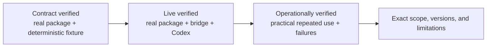

# Integrations and verification scope

**English (canonical)** | [日本語](integrations.ja.md)

English is canonical if translations differ. [README](../README.md)

Provider capability and consumer compatibility are separate contracts. The bridge keeps the
Codex-backed API subset narrow while testing each consumer's real emitted HTTP shape through the
loopback route, strict parser, upstream projection, and consumer-native response parser.

Status meanings:

- **Contract verified** — the pinned real package's serializer/parser completed the listed contract
  against a deterministic upstream fixture. This proves an exact wire shape, not live provider use.
- **Live verified** — the pinned real package completed a representative operation through the
  running bridge and real Codex backend.
- **Operationally verified** — a practical application was used repeatedly with real data or source,
  including the documented multi-turn/tool and failure-recovery boundaries.
- **Unsupported / external provider required** — the Codex backend cannot supply the capability, or
  the bridge intentionally leaves it to a separate authority such as an embedding provider.

Qualifiers such as `configuration required`, `adapter required`, `scoped`, `constrained role`, and
`component only` narrow those evidence levels. A fixture or serializer compatibility alone is not an operational support claim, and no row implies support for an unlisted product surface.

The additional qualifier `user-reported` attributes practical use to the operator's report, not an
independently repeated maintainer run. Unhush's earlier evidence had that qualifier; its guide now
separately records a bounded maintainer-executed formatter trial with an isolated recorder fixture.

## Latest stable — checked 2026-11-15

These are exact, officially published stable releases as of this check, not a moving promise about
future versions. Selection excludes prerelease/dev/yanked artifacts and distinguishes a component
from a product CLI. [Machine-readable versions, dates, sources and receipts](integrations/latest-stable-evidence.json)
record the tested dependency tuples. Aider retains its publisher-pinned older dependencies.

The isolated real-Codex trial passed 16 cases / 21 API requests, all HTTP 200, against an owned
static-model bridge (`codex` → `gpt-6.1-sol`). Its process and listener were closed afterward; this
was not a production deployment, model-discovery trial, or full-product endurance qualification.
The narrower latest scope below does not erase or inherit the older operational evidence.

| Consumer / tool | Latest stable | Current evidence | Exact boundary / remaining gaps |
| --- | --- | --- | --- |
| OpenAI Python SDK | 3.51.0 | **Live verified** + native typed contracts | Async Chat/Responses buffered/streamed; structured/function/custom-tool, cache-write and compaction contracts. `max_retries=0`; other OpenAI APIs and longevity unclaimed |
| Unhush Custom Formatting | 3.3.4, source `657352ea22c0738fe1c3a26005c2365032d02746` | **Live verified, source client only**; 13 consumer contracts, 3 real formatter calls | Not the 3.3.4 packaged RecordingBar/stop/fallback/length/90s/UI/restart path. AppImage hash/extraction only; keep the 3.1.0 packaged evidence separate |
| Honcho server | 3.6.1, source `70c67624169683b9e265517aec95a51b8077cabc` | **Contract verified, native backend/codec**; 6 cases, 7 HTTP 200 | Consumer Python 3.13.15 / SDK 3.51.0 / Pydantic 2.14.3 → separate actual bridge Python 3.12.3 / SDK 1.109.1 / Pydantic 2.13.4; synthetic upstream. No real provider, DB/Redis/fullservice; #1061 null fix is included. Earlier 3.13-bridge probe and 4 upstream regressions remain separate |
| LangChain `ChatOpenAI` | `langchain-openai`/`langchain-core` 1.8.0; SDK 3.51.0 | **Live verified, scoped**; 5 contracts + 4 live cases | Chat/Responses text, Chat local tool roundtrip and Responses Pydantic schema. Older RAG/LangGraph/SQLite/HITL/concurrency/failure campaign not rerun; installed dependencies are not operational evidence |
| OpenAI Agents SDK | 0.24.0; SDK 3.51.0 | **Live verified, Chat model**; 3 contracts + 2 live cases | Basic Runner + stream; local tool loop contract only. Disable tracing. ResponsesModel, sessions and hosted tools not qualified |
| AutoGen | ext/core/agentchat 0.7.5; SDK 3.51.0 | **Live verified, direct client**; 3 contracts + 2 live cases | Direct text/stream live; schema and conditional-tool/reflection adapter contract. Teams, hosted agents, memory/code execution not qualified |
| Aider | 0.86.2; LiteLLM 1.81.10 / SDK 2.20.0 | **Contract verified**, 2 cases; still latest stable | Constrained one-file streaming `whole` edit. Do not force newer standalone dependency releases into the published tuple; no new live/interactive/endurance claim |
| Cline CLI Linux x64 | 3.0.74 | **Live verified**, constrained edit; 2 contracts + 1 live case | Omit `--thinking none`; retain local-only controls/short prompt/native guard. Live used 4 calls of the 3 allowed tool types; HEAD unchanged, one file only. Other platforms/roles unclaimed |
| Continue core provider | `@continuedev/core` 1.1.0; `tsx` 4.23.12 | **Contract verified**, 3 cases; still latest stable | Exact published component artifact, not current `cn` CLI (`@continuedev/cli` 1.5.47). Chat/Edit/tool result only; no Apply/IDE/embedding/endurance claim |

The SDK CI lane has 142 checks: 21 actual SDK cases, 7 historical Honcho request-shape cases and
114 shared usage-normalization checks. The 7 historical shapes do not qualify the latest Honcho
backend; its actual native probe is separate. Optional consumers are test-only dependencies.

## Historical baselines

The following records retain their original exact versions and scope. Their broader operational
grades are **not** transplanted to the newer releases above; conditions describe those snapshots.

| Consumer / tool | Status | Known-good version | Verified scope | Not verified / required conditions |
| --- | --- | --- | --- | --- |
| OpenAI Python SDK | **Live verified** | 1.109.1 and 3.1.0 | Live Chat/Responses non-stream and stream plus offline structured output, function/custom-tool, usage, and compaction contracts | Use `max_retries=0`; this is not verification of unsupported OpenAI API surfaces or long-running application behavior |
| Unhush Custom Formatting | **Operationally verified (scoped)** | Linux AppImage 3.1.0, pinned source and package hash | Source-locked contracts; isolated packaged formatter/stop path with synthetic recorder completion; real Codex warm-up, three repeats, injected failure recovery, length guards, native 90-second abort, Formatting UI save/reload and app restart | Formatting only; not microphone/STT, normal desktop clipboard/typing/hotkeys, full UI or long-session acceptance. Bare URL without `/v1`, bridge token and cloud text disclosure apply. Live trial used `default` → `gpt-6.1-sol`; other prompts/models/builds/platforms are not certified |
| Honcho | **Operationally verified** | Self-hosted request shape based on revision `444897975c95393b0d48024470ece03c025d3aa4` | Repeated derivation, summary/dream/dialectic generation, structured output, memory-search tool continuation, restart, queue, and existing PostgreSQL/Redis continuity | Embeddings require a separate backend; lossless nullable tool-call content currently requires the compatibility fix tracked in [plastic-labs/honcho#1061](https://github.com/plastic-labs/honcho/issues/1061) |
| LangChain `ChatOpenAI` | **Operationally verified (scoped)** | `langchain-openai` 1.6.0, `langchain-core` 1.6.0, `langgraph` 1.2.11, `langchain` 1.3.17, `langchain-ollama` 1.1.0, `langgraph-checkpoint-sqlite` 3.1.1, OpenAI SDK 3.3.1 | Live non-stream, sync stream, asynchronous Responses streaming with the official aiohttp transport, strict Pydantic output, one-tool and sequential multi-tool Responses, sequential multi-tool Chat, three-turn history, bounded `batch()`/`abatch()` concurrency (4 inputs, maximum 2), recovery after one injected 429 and one mid-stream disconnect, a bounded LangGraph read-only graph, plain-text in-memory RAG through external Ollama `embeddinggemma`, standard `create_agent` in Chat Completions mode, and consumer-side SQLite interrupt/resume | Set `temperature=None`, `max_retries=0`, select `use_responses_api`, install `openai[aiohttp]`, own explicit sync/async clients with `trust_env=False`, set `http_socket_options=()`, and require a typed completed terminal. Persistent vector stores, production-corpus retrieval evaluation, PostgreSQL checkpoints, concurrent checkpoint writers, multiple interrupts, standard-agent Responses mode, daemon longevity, concurrency above 2, and repeated exhaustion/interruption remain unverified |
| OpenAI Agents SDK | **Live verified (configuration required)** | `openai-agents` 0.21.1, OpenAI SDK 3.2.0 | Live `OpenAIChatCompletionsModel` basic agent and local `function_tool` loop; offline stream contract | Disable tracing; `OpenAIResponsesModel`, sessions, and hosted tools are not verified |
| AutoGen | **Contract verified (adapter required)** | `autogen-ext`/`autogen-core`/`autogen-agentchat` 0.7.5, OpenAI SDK 3.2.0 | Direct non-stream/stream and Pydantic JSON Schema; one `AssistantAgent` local function-tool/reflection contract | Requires explicit model metadata and the conditional parallel-tools adapter; live sustained use, teams, code execution, memory, and hosted agents are not verified |
| Aider | **Contract verified (constrained role)** | `aider-chat` 0.86.2, LiteLLM 1.81.10, OpenAI SDK 2.20.0 | One-shot CLI `--message` contract performs a streaming `whole`-format edit of one existing file | Live sustained use, interactive mode, auto-commit, repo map, architect/weak-model flows, and other edit formats are not verified |
| Cline CLI | **Live verified (constrained role)** | Linux x64 binary 3.0.55 | One live headless `read_files` → `editor` → `submit_and_exit` edit of one existing file | Requires the documented local-only flags and short system prompt; sustained use, other platforms, default control plane, shell/web/MCP/subagents/teams, IDE/TUI, and non-idempotent tools are not verified |
| Continue core OpenAI provider | **Contract verified (component only)** | `@continuedev/core` 1.1.0, `tsx` 4.23.12 | Public `streamChat`, Edit-role `streamComplete`, and non-stream function-tool result contract | Chat/Edit component only; live sustained use, Apply/file mutation, current `cn` CLI, autocomplete, embeddings, and IDE UI are not verified |

For LangChain, this is one-shot batch/concurrency evidence; repeated batch/concurrency runs remain unverified.
In particular, repeated exhaustion/interruption remains unverified; daemon-mode use remains unverified.
The unverified scope includes persistent vector stores, production-corpus retrieval evaluation,
PostgreSQL checkpoints, concurrent checkpoint writers, and multiple interrupts;
standard-agent Responses mode remains unverified.

The LangGraph, RAG, standard-agent, and HITL claims are consumer-side and scope-exact.
RAG uses an external Ollama `embeddinggemma` backend at 768 dimensions and does not add Embeddings capability to the bridge.
HITL uses a consumer-side SQLite checkpointer; the bridge remains stateless and receives no HITL pause/resume request.
The verified RAG store is disposable/in-memory. The standard agent has no middleware, store, or checkpointer and is
Chat-Completions-only with read-only repository tools.

These framework packages are isolated CI contract dependencies, not bridge runtime dependencies.
Their tests use synthetic credentials and deterministic upstream fixtures, so normal project tests
and production deployment do not install or contact the frameworks' external services.

## Configuration recipes

- [OpenAI Python SDK](integrations/openai-python.md)
- [Unhush Custom Formatting](integrations/unhush.md)
- [Honcho](integrations/honcho.md)
- [LangChain](integrations/langchain.md)
- [OpenAI Agents SDK](integrations/agents.md)
- [AutoGen](integrations/autogen.md)
- [Aider](integrations/aider.md)
- [Cline CLI](integrations/cline.md)
- [Continue core](integrations/continue.md)
