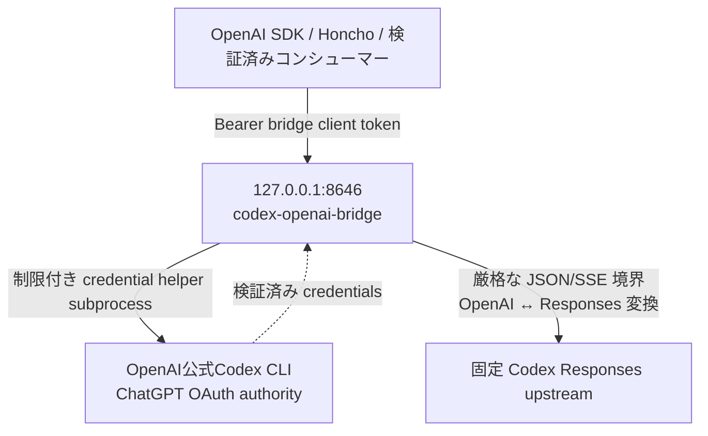

# 導入と認証

[English (canonical)](setup.md) | **日本語**

英語版を正本（canonical）とします。 [README](../README.ja.md)

## Codex CLIの準備

bridge hostへOpenAI公式Codex CLIをinstallしてください。
このreleaseではCodex CLI 0.146.0が検証済みversionです。
他のCodex CLI versionは未検証です。

```bash
codex --version
```

login前に、初期対応するcredential storeであるfile modeを`$HOME/.codex/config.toml`へ設定します。

```toml
cli_auth_credentials_store = "file"
```

その後、ChatGPTでloginします。

```bash
codex login                 # or: codex login --device-auth
codex login status
```

login後にcredential directoryとfileのauthorityを正規化します。

```bash
chmod 700 "$HOME/.codex"
chmod 600 "$HOME/.codex/auth.json"
```

生成される`$HOME/.codex/auth.json`はpasswordと同等に扱ってください。owner-only、mode `0600`を
維持し、issue、log、chat、このrepositoryへコピーしないでください。keyringと`auto` storageは
このreleaseでは非対応です。Hermesは不要です。第三者agent frameworkも必要ありません。

認証readerは、従来の3 fieldのChatGPT fileと、それに`"auth_mode": "chatgpt"`を加えた
形式を受け付けます。ほかのmode、未知field、重複key、API key、account不一致は引き続き
拒否します。CLIが管理する認証fileから`auth_mode`を削除しないでください。

bridgeの仮想環境を作成したPython 3.12は削除しないでください。実行中のbridgeが残っていても、
interpreterを削除すると新しい認証helperを起動できなくなります。processの生存とreadinessは
別です。serviceを再起動する前に、installed Python 3.12と`uv.lock`から環境を再作成し、
`/readyz`と実requestを確認してください。

API key認証は意図的に非対応です。OpenAI API keyを利用する場合は、このbridgeを使わず
公式OpenAI APIへ直接接続してください。API key fallbackやprovider切替は追加しません。

## 初回のキー生成

初回導入だけで実行します。通常更新では既存の2つのキーを保持してください。既存file・symlinkが1つでもあれば、値を変更せず停止します。同時作成でもexclusive createで既存値を上書きしません。途中のI/O失敗でfileが残った場合も、自動削除や再生成はせず状態を確認してください。

<!-- initial-credentials -->
```python
from pathlib import Path
import os
import secrets

config = Path.home() / ".config"
config.mkdir(mode=0o700, exist_ok=True)
root = config / "codex-openai-bridge"
root.mkdir(mode=0o700, exist_ok=True)
directory = os.open(root, os.O_RDONLY | os.O_DIRECTORY | os.O_NOFOLLOW)
try:
    if os.fstat(directory).st_uid != os.geteuid():
        raise SystemExit("Credential directory must belong to the current user.")
    names = ("client-token", "continuation-key")
    for name in names:
        try:
            os.stat(name, dir_fd=directory, follow_symlinks=False)
        except FileNotFoundError:
            pass
        else:
            raise SystemExit(
                "Existing credentials found; preserve them. Do not regenerate on upgrade."
            )
    values = [secrets.token_urlsafe(32), secrets.token_urlsafe(32)]
    if values[0] == values[1]:
        raise SystemExit("Generated identical keys; nothing written. Try again.")
    os.fchmod(directory, 0o700)
    for name, value in zip(names, values, strict=True):
        fd = os.open(name, os.O_WRONLY | os.O_CREAT | os.O_EXCL, 0o600, dir_fd=directory)
        with os.fdopen(fd, "w", encoding="ascii") as stream:
            stream.write(value + "\n")
finally:
    os.close(directory)
```

上のPythonを`uv run python`で実行します。値は表示せず、repository・unit・journal・command historyへ置かないでください。`client-token`だけをconsumerへ渡し、`continuation-key`はserverだけで保持します。署名keyはbridge client tokenとは異なる値でなければなりません。2つは異なる43文字の値、file modeは`0600`です。

## アーキテクチャ



bridgeはserverが承認したaliasだけを公開します。信頼されたサーバー側の状態から実upstream model、URL、authorization、account、`store:false`、streaming policy、encrypted-reasoning include policyを再構成します。`/v1/models`、Chat、Responses、SSE projectionは実upstream model identifierを返しません。

## セキュリティ上の前提

- Bind addresses は loopback IPs でなければなりません。デフォルト値およびデプロイ時の値は `127.0.0.1` です。
- 保護対象の各 endpoint では、専用の 43 文字のブリッジ client token が必要です。この token は Codex OAuth token ではありません。
- ブリッジ client token は、owner-only、mode `0600`、non-symlink regular file から読み込まれます。
- Codex OAuth credentialsは、OpenAI公式Codex CLIのfile storeから制限付きhelperを通して読みます。loginとrefreshを書き込むauthorityはCodex CLIだけであり、このrepositoryやsystemd unitへcredentialをコピーしません。
- Upstream URL、authorization、account ID、model、prompts、tool arguments、encrypted reasoning は、operational logs と sanitized errors から除外されます。
- Request bodies、JSON structure、helper output、upstream bodies、SSE events/streams、queueing、concurrency、deadlines、shutdown には制限が適用されます。
- OpenAI公式Codex CLIが認証状態をatomicに更新する場合があるため、`ProtectHome=read-only`は検証済みの具体的な`--codex-home`をrenderした`ReadWritePaths=`に対してだけ緩和されます。生成される`CODEX_BRIDGE_CODEX_HOME`と`ReadWritePaths=`は同一のexact pathです。
- sandbox は、意図しないアクセスと service compromise の影響を軽減します。同じ Unix UID ですでに実行されているあらゆる malicious process から保護できるとはしていません。
- port 8646 を public reverse proxy 経由で公開しないでください。信頼できる remote コンシューマーが必要な場合は、別途レビューした authenticated tunnel を使用し、loopback bind を維持してください。
