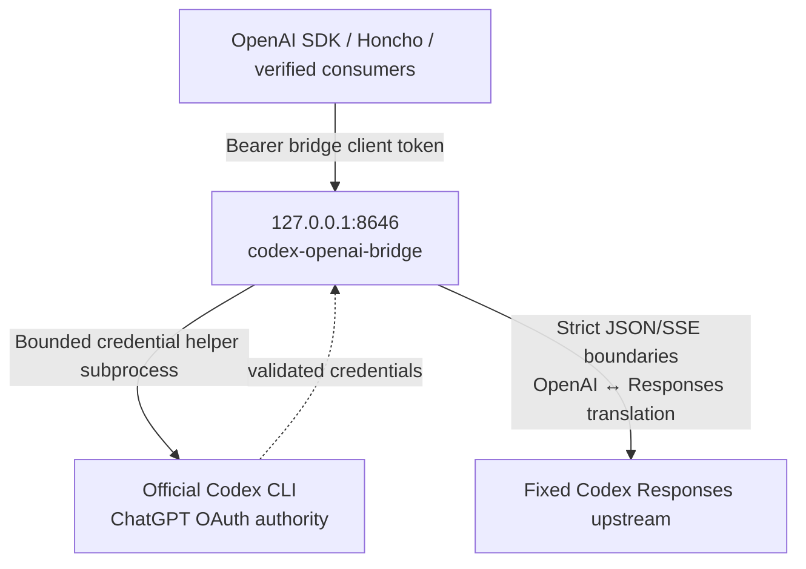

# Setup and authentication

**English (canonical)** | [日本語](setup.ja.md)

English is canonical if translations differ. [README](../README.md)

## Prepare the Codex CLI

Install the official OpenAI Codex CLI on the bridge host.
Codex CLI 0.146.0 is the verified version for this release.
Other Codex CLI versions remain unverified.

```bash
codex --version
```

Before login, configure the initial supported credential store, file mode, in
`$HOME/.codex/config.toml`:

```toml
cli_auth_credentials_store = "file"
```

Then sign in with ChatGPT:

```bash
codex login                 # or: codex login --device-auth
codex login status
```

Normalize the credential directory and file authority after login:

```bash
chmod 700 "$HOME/.codex"
chmod 600 "$HOME/.codex/auth.json"
```

The resulting `$HOME/.codex/auth.json` is password-equivalent. Keep it owner-only at mode `0600`
and never copy it into issues, logs, chat, or this repository.
Keyring and `auto` storage are not supported by this release. Hermes is not required;
no third-party agent framework is required.

The credential reader accepts the original three-field ChatGPT file and the same file with
`"auth_mode": "chatgpt"`. Other modes, unknown fields, duplicate keys, API keys, and account
mismatches remain rejected. Do not edit the CLI-owned credential file to remove `auth_mode`.

Keep the Python 3.12 interpreter used to create the bridge virtual environment installed.
A running bridge can survive removal of that interpreter while new credential helpers fail;
process liveness is not readiness. Recreate the environment from `uv.lock` with an installed
Python 3.12 before restarting the service, then verify `/readyz` and a real request.

API-key authentication is intentionally unsupported. If you have an OpenAI API key,
use the official OpenAI API directly without this bridge; this project will not add an API-key
fallback or provider switch.

## Initial key provisioning

Run only for a fresh installation. Preserve both existing keys during ordinary upgrades. An existing file or symlink stops this example without changing its value. Exclusive creation also prevents concurrent replacement. If an I/O failure leaves a partial installation, inspect it rather than deleting or regenerating keys automatically.

<!-- initial-credentials -->
```python
from pathlib import Path
import os
import secrets

config = Path.home() / ".config"
config.mkdir(mode=0o700, exist_ok=True)
root = config / "codex-openai-bridge"
root.mkdir(mode=0o700, exist_ok=True)
directory = os.open(root, os.O_RDONLY | os.O_DIRECTORY | os.O_NOFOLLOW)
try:
    if os.fstat(directory).st_uid != os.geteuid():
        raise SystemExit("Credential directory must belong to the current user.")
    names = ("client-token", "continuation-key")
    for name in names:
        try:
            os.stat(name, dir_fd=directory, follow_symlinks=False)
        except FileNotFoundError:
            pass
        else:
            raise SystemExit(
                "Existing credentials found; preserve them. Do not regenerate on upgrade."
            )
    values = [secrets.token_urlsafe(32), secrets.token_urlsafe(32)]
    if values[0] == values[1]:
        raise SystemExit("Generated identical keys; nothing written. Try again.")
    os.fchmod(directory, 0o700)
    for name, value in zip(names, values, strict=True):
        fd = os.open(name, os.O_WRONLY | os.O_CREAT | os.O_EXCL, 0o600, dir_fd=directory)
        with os.fdopen(fd, "w", encoding="ascii") as stream:
            stream.write(value + "\n")
finally:
    os.close(directory)
```

Run the Python above with `uv run python`. Do not print values or put them in the repository, unit, journal, or command history. Give consumers only `client-token`; keep `continuation-key` server-only. The signing key must differ from the bridge client token. The two values are distinct 43-character keys at mode `0600`.

## Architecture



The bridge exposes only server-approved aliases. It reconstructs the real upstream model, URL, authorization, account, `store:false`, streaming policy, and encrypted-reasoning include policy from trusted server-side state. Real upstream model identifiers are never returned by `/v1/models`, Chat, Responses, or SSE projections.

## Security assumptions

- Bind addresses must be loopback IPs. The default and deployed value is `127.0.0.1`.
- Every protected endpoint requires a separate 43-character bridge client token. This token is not the Codex OAuth token.
- The bridge client token is loaded from an owner-only, mode `0600`, non-symlink regular file.
- Codex OAuth credentials are read from the official Codex CLI file store through a bounded helper. The Codex CLI remains the only login and refresh authority; credentials are not copied into this repository or the systemd unit.
- Upstream URL, authorization, account ID, model, prompts, tool arguments, and encrypted reasoning are excluded from operational logs and sanitized errors.
- Request bodies, JSON structure, helper output, upstream bodies, SSE events/streams, queueing, concurrency, deadlines, and shutdown are bounded.
- `ProtectHome=read-only` is relaxed only for the validated concrete `--codex-home` rendered into `ReadWritePaths=` because the official Codex CLI may atomically refresh authentication state there. The generated `CODEX_BRIDGE_CODEX_HOME` and `ReadWritePaths=` authorities are the same exact path.
- The sandbox reduces accidental access and service compromise impact. It does not claim protection from every malicious process already running as the same Unix UID.
- Do not expose port 8646 through a public reverse proxy. If a remote trusted consumer is required, use a separately reviewed authenticated tunnel and preserve the loopback bind.
